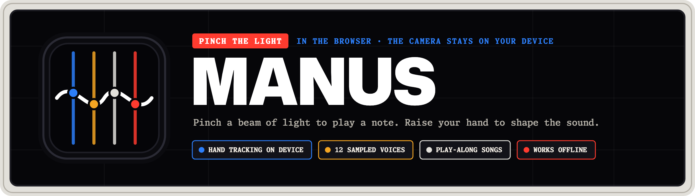
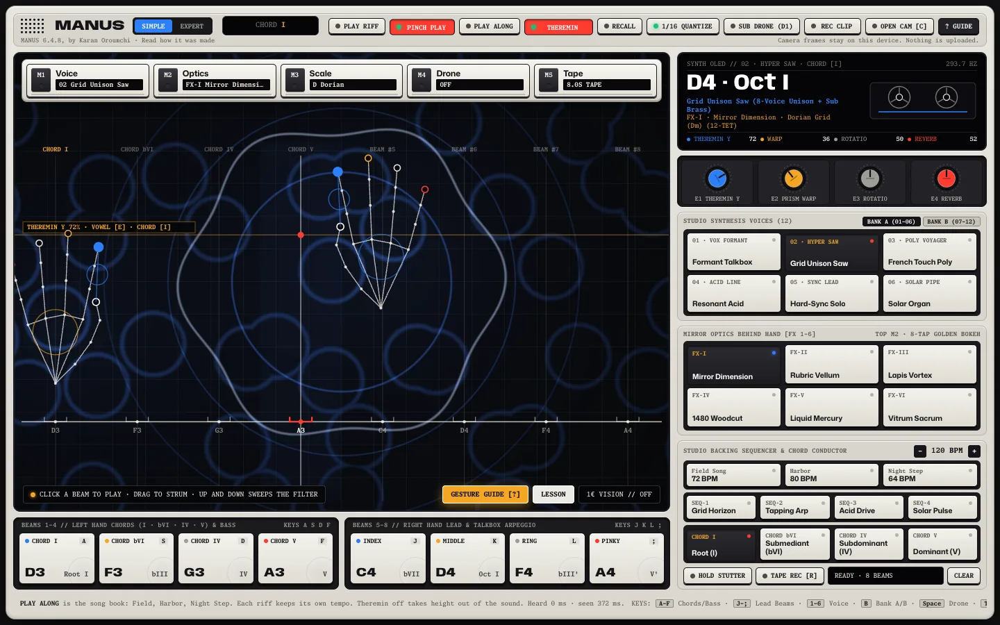

<div align="center">
  
</div>

# MANUS

Pinch the light to play. MANUS is a laser harp in the browser: the webcam finds your hands, you pinch one of eight beams of light to play a note, and the height of your hand shapes the sound. Hand tracking runs on your device, so nothing from the camera is uploaded.

**[Play it at manus.karano.me](https://manus.karano.me)** · [How it was made](https://karano.me/work/manus) · [Changelog](./CHANGELOG.md)



It plays best on a laptop with a webcam. Without a camera, the mouse and the keyboard reach every part of it. On a phone the controls stack under the stage and the page scrolls.

## Playing it

| You | MANUS |
|---|---|
| Move a hand left or right | Aims at one of the eight beams |
| Pinch thumb and index on a beam | Plays it. Hold the pinch and drag to strum |
| Raise or lower the hand | Sweeps the filter, moves the vowel between U and I, adds reverb and bends the pitch |
| Close the left hand for about half a second | Holds a low drone and plays a chord |
| Reach into the five buttons along the top | Changes the voice, the look, the scale, the drone or the tape loop |

The height range stops just under those five buttons, so playing a melody never changes a setting by accident. Every control has a key as well: `A S D F` and `J K L ;` play the beams, `1` to `6` pick a voice, and `?` lists the rest.

There are 12 voices in two banks, six looks for the camera picture, four backing loops to jam over, and three songs to play along with. In a song, a gem falls toward each beam, and catching it on the line scores it.

## How it works

Everything runs in one browser tab: camera, hand tracking, smoothing, gestures, then sound and picture.

- MediaPipe's Hand Landmarker finds 21 points on each hand, on the GPU, with the CPU as a fallback. The model and its WebAssembly, about 10 MB, load only when the camera turns on, so a first visit stays small.
- Every point goes through a 1-Euro filter, which holds still while the hand is still and keeps up when it moves fast.
- `lib/gestures.ts` turns the points into a beam, a pinch, a height and a fist. The pinch can be calibrated to a player's hand, and the browser remembers it.
- `lib/audio.ts` is the sound, in Web Audio. Each of the 12 voices has four sampled pitch zones (48 samples, rendered from Surge XT presets) layered with oscillators, plus a vowel filter, a drum machine with sidechain and a tape looper. In Expert mode it follows an external MIDI clock.
- `lib/shader.ts` is a WebGL2 shader with six looks. It reads a mask of the hands, so the picture bends behind them while the hands stay sharp.
- `lib/camera.ts` picks the selfie camera that faces the player, including on a foldable with one camera per screen, and `lib/camera-fit.ts` crops the picture to the stage without stretching it.
- A service worker caches the app. Once opened, MANUS plays without a connection, and hand tracking works offline after the camera has been on once.

A few numbers: 56 frames a second in Chrome on a Mac with a recorded hand, and a note heard about 27 ms after it is triggered in the browser. The native Android version, with a C++ sound engine, gets that to about 9 ms. It lives in its own repository.

## Privacy

Camera frames and sound stay on the device. Vercel Web Analytics counts page views and a few steps of a first play, once per visit each: the camera turned on or refused, the first note, the first song, the first gem caught, and a browser coming back. It uses no cookies and never sees the camera or the sound.

## Run it

Node.js 20.9 or newer.

```bash
npm install
npm run dev        # http://127.0.0.1:3320
npm run check      # type-check, lint and build
```

The tests run against a production build:

```bash
npm run build && npm run start -- --port 3322
npm run test:e2e   # in a second terminal
```

They drive the installed Google Chrome with WebGL in software and a fake camera, so the hand-tracking path runs headless. Some run in Node instead, putting made-up hands through the same gesture code the stage uses. `E2E_ORIGIN=https://manus.karano.me npm run test:e2e` points them at the live site.

Other scripts: `node scripts/render-banner.mjs` draws the banner above from its SVG, `node scripts/pwa-screenshots.mjs` takes the install sheet's screenshots from a running build, and `node scripts/credit.mjs` writes the author credit into every image the site serves.

## Layout

```
app/page.tsx              the console: controls, panels, keys, setlists
components/StageCanvas.tsx camera, tracking loop, beams and the shader stage
lib/audio.ts              the sound engine
lib/gestures.ts           smoothing and the gesture rules
lib/shader.ts             the six WebGL2 looks
lib/camera.ts             which selfie camera to open
lib/camera-fit.ts         the crop that keeps the picture's shape
lib/events.ts             the cookie-free play counters
public/samples            the rendered voices and loops
public/wasm, public/models MediaPipe's runtime and hand model, served by the app
tests/e2e                 Playwright tests and Node tests
```

## Credits and licence

Hand tracking is [MediaPipe](https://github.com/google-ai-edge/mediapipe) and its Hand Landmarker model, under the Apache License 2.0. The voices are renders of [Surge XT](https://surge-synthesizer.github.io/) presets. The fonts are Mona Sans and Monaspace by GitHub and Anybody by Etcetera Type Co, under the SIL Open Font License 1.1. Details and licence texts are in [THIRD_PARTY_NOTICES.md](./THIRD_PARTY_NOTICES.md) and [licenses/](./licenses).

MANUS itself is © 2026 Karan Oroumchi, all rights reserved. The code is published for reading. Copying or reusing it needs written permission; see [LICENSE](./LICENSE).

Designed and built by Karan Oroumchi, [karano.me](https://karano.me).
